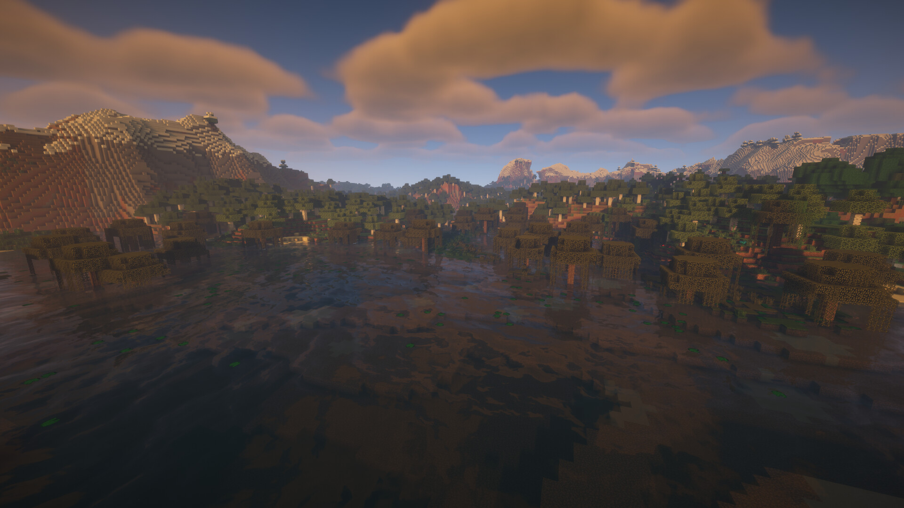
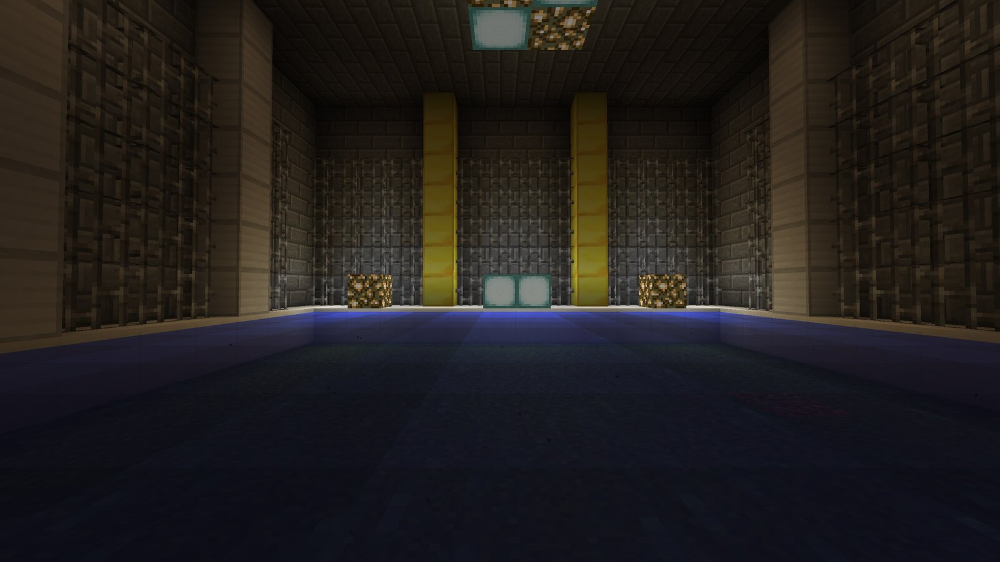
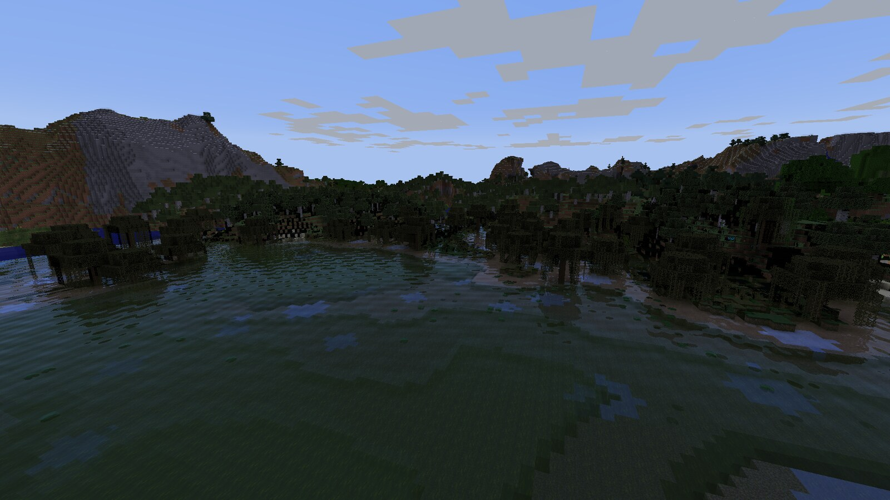
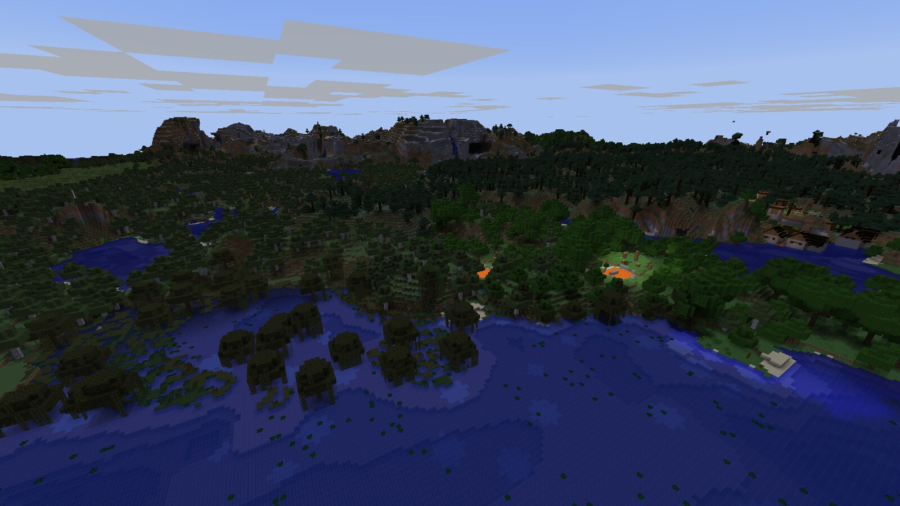
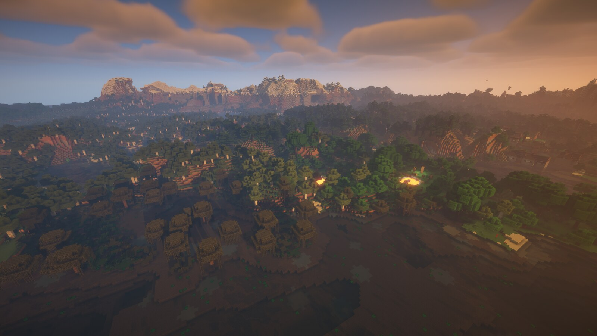
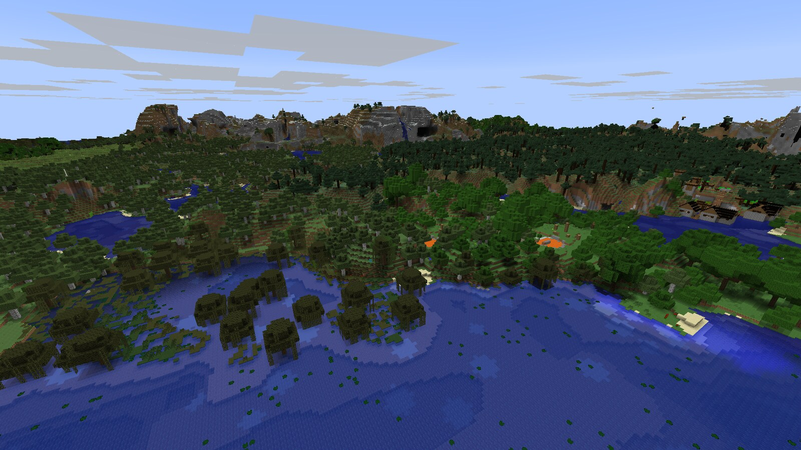
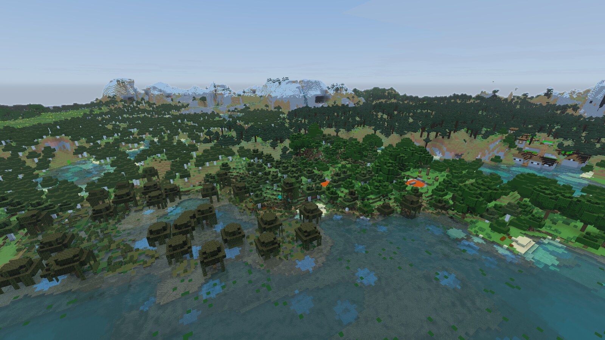
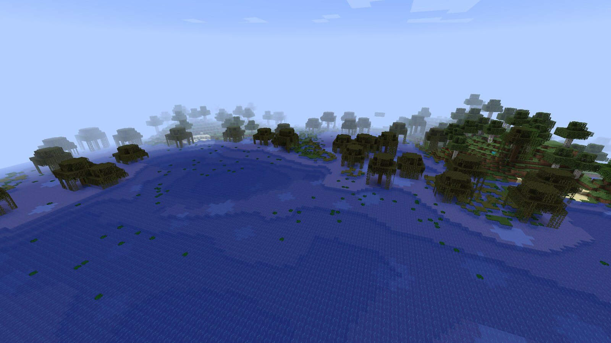
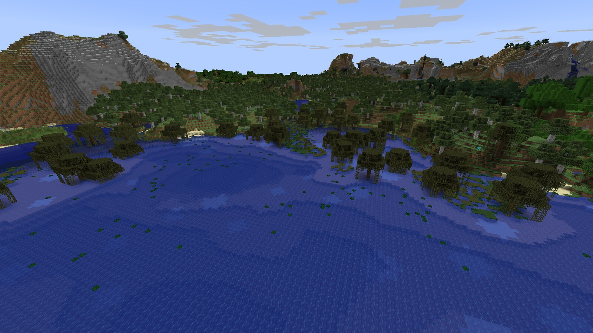
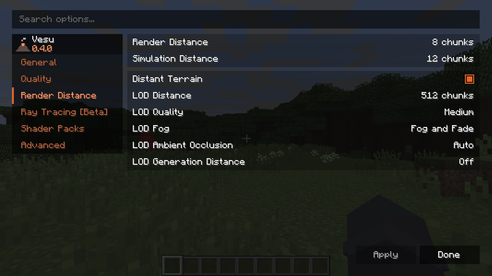

# Vesu

**A Vulkan renderer for Minecraft 1.12.2.**

[![GitHub][github-badge]][github]
[![Discord][discord-badge]][discord]
![Modrinth: not published yet][modrinth-badge]
![CurseForge: not published yet][curseforge-badge]

[github-badge]: https://img.shields.io/badge/GitHub-Source-181717?style=for-the-badge&logo=github&logoColor=white
[github]: https://github.com/Vendetta1871/vulkanmod-legacy
[discord-badge]: https://raw.githubusercontent.com/Vendetta1871/vulkanmod-legacy/master/docs/badges/discord.svg
[discord]: https://discord.gg/gvmeswCQFP
[modrinth-badge]: https://img.shields.io/badge/Modrinth-Soon-555555?style=for-the-badge&logo=modrinth&logoColor=white
[curseforge-badge]: https://raw.githubusercontent.com/Vendetta1871/vulkanmod-legacy/master/docs/badges/curseforge.svg

Vesu turns Minecraft 1.12.2's OpenGL draw calls into Vulkan renderer: a shader-pack runtime, ray tracing, FSR
upscaling and frame generation, and distant terrain that pushes the horizon far past the vanilla
render distance.

## Ray tracing [Beta]

  
  

<b>Left:</b> ray tracing off. <b>Right:</b> ray tracing on, 32-chunk effect range.

## Shader packs

  
  

<b>Left:</b> vanilla rendering through Vesu. <b>Right:</b> BSL Shaders, unchanged.

Vesu runs both Iris/OptiFine compatible shaders. There are also a built-in sample pack and Vibrant Visuals.

## Vibrant Visuals, built in

  
  

<b>Left:</b> off. <b>Right:</b> the built-in Vibrant Visuals pack.

Vibrant Visuals brings the Bedrock-style atmosphere.

## Distant terrain

  
  

<b>Left:</b> render distance 8, no distant terrain. <b>Right:</b> render distance 8 plus LOD terrain.

Vesu builds simplified terrain and draws it past the vanilla render distance - up to
2048 chunks. Shader packs are compatible.

## Performance

Intel UHD 620, 1600x900, render distance 12

| Configuration | Avg FPS | 1% low | 0.1% low |
|--------------------------------------------|---------|--------|----------|
| **Vesu (this mod)** on Cleanroom 0.7.12 | **175.2** | 64.0 | 40.9 |
| Cleanroom 0.6.13 + Actinium alpha-0.0.13   | 153.9   | 78.3 | 37.9 |
| Cleanroom 0.7.12 (base, no renderer mod)   | 136.4   | 61.7 | 40.7 |
| Forge 14.23.5.2860 (no mods)               | 131.1   | 51.9 | 33.2 |
| Forge 14.23.5.2860 + OptiFine HD U G5      | 126.5   | 51.9 | 32.8 |

## Settings

All the graphics options live in **Options -> Video Settings**.

## Compatibility and known limitations

- Minecraft 1.12.2 with Cleanroom (LWJGL3 and Kilo's GL-state tracking are provided by Cleanroom;
  this port was developed against Cleanroom 0.7.12-alpha).
- Some niche GL paths or heavily mixin-modded renderers may still
  fall through or render incorrectly - please open an issue with a screenshot and your mod list.

## Credits

[VulkanMod](https://github.com/xCollateral/VulkanMod) by **xCollateral**
